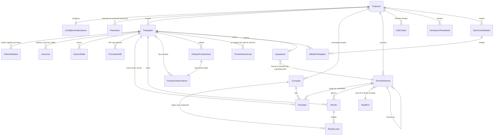

# Nómina Venezuela — Fase 1: Modelo de datos

> **Aviso:** los cálculos de este módulo deben ser validados por un contador
> público colegiado, y cada parámetro verificado contra la Gaceta Oficial
> vigente antes de procesar un período.

Estado: **PROPUESTA — pendiente de aprobación.** No se ha modificado
`prisma/schema.prisma` ni el código existente. Al aprobar esta fase se
integran los modelos y empieza la Fase 2 (motor de cálculo + pruebas).

---

## 0. Punto de partida: lo que ya existe en ContaVE

ContaVE ya tiene un módulo de nómina (`src/lib/contabilidad/nomina.ts`,
`nomina-lottt.ts`, modelos `Empleado`, `Nomina`, `NominaDetalle`, `Vacacion`,
`Liquidacion`). Lo revisé contra el prompt maestro y **no sirve como base del
motor nuevo**, por estas razones:

| # | Problema en el módulo actual | Regla incumplida |
|---|---|---|
| 1 | Todos los montos son `Float` | Precisión monetaria (nunca float) |
| 2 | IVSS trabajador 4 % escrito en el código; % patronales como columnas de `Empresa` sin vigencia ni fuente | Tabla de parámetros con vigencia |
| 3 | IVSS calculado sobre salario proporcional, sin contar lunes ni tope de 5 salarios mínimos | Ley del Seguro Social |
| 4 | No calcula el RPE (paro forzoso) | Ley del RPE |
| 5 | FAOV sobre salario normal (debe ser integral) | Ley RPVH |
| 6 | INCES patronal mensual, sin el umbral de 5+ trabajadores | Ley del INCES |
| 7 | No existe la contribución especial de pensiones (9 %) | GO 6.806 Ext. / Decreto 4.952 |
| 8 | Garantía de prestaciones = 5 días al mes, no 15 días por trimestre con el salario del último mes; sin días adicionales ni intereses | LOTTT Art. 142 a, b; Art. 143 |
| 9 | Retroactivo = 30 días × años **decimales** (debe ser por año o fracción > 6 meses) | LOTTT Art. 142 c |
| 10 | Alícuota de utilidades = salario diario × % fijo (no usa días de utilidades ni la alícuota de BV) | LOTTT Art. 104 |
| 11 | Vacaciones pendientes = "contar registros", sin calendario de aniversarios ni feriados | LOTTT Arts. 190-192 |
| 12 | Sin cestaticket en USD/tasa BCV, sin conceptos con banderas, sin horas extra, bono nocturno, feriados | LOTTT Arts. 117-120; Ley de Alimentación |
| 13 | El período procesado no se bloquea ni se puede reversar documentadamente | Auditoría |

**Propuesta:** construir un módulo nuevo `src/lib/nomina/` (motor puro en
`src/lib/nomina/engine/`) con tablas nuevas, migrar los empleados existentes
con un script, y retirar el módulo viejo cuando el nuevo esté en producción
(ver pregunta P1 al final).

---

## 1. Principios del modelo

1. **Nada a mano.** Todo porcentaje, tope, mínimo, días legales o tasa vive en
   `Parametro` con `vigenteDesde` / `vigenteHasta` y `fuente` obligatoria.
   Incluye también los valores "fijos" de la LOTTT (15 días de garantía,
   30 % de bono nocturno, etc.), porque una reforma también los cambiaría.
2. **Snapshot al calcular.** Cada línea de recibo guarda copia del concepto,
   sus banderas, los parámetros usados y la tasa BCV. Un período cerrado se
   puede reimprimir idéntico aunque luego cambien parámetros o banderas.
3. **Dinero en `Decimal`.** Postgres `numeric`; en el motor `decimal.js`.
   Montos finales `Decimal(18,2)`; tasas BCV `Decimal(20,8)`; porcentajes
   `Decimal(9,6)` (se guardan como porcentaje: `9` = 9 %). Se redondea a
   2 decimales al final de cada concepto, nunca en pasos intermedios (el
   desglose guarda los intermedios con precisión completa).
4. **Doble moneda.** Toda línea guarda `montoOrigen` + `monedaOrigen` +
   `tasaBCV` + `fechaTasa` + `montoVES`.
5. **Multiempresa.** Todo cuelga de `empresaId` y se filtra en la capa de
   servicio, igual que el resto de ContaVE (`UserEmpresa` ya da el acceso del
   contador a varias empresas). La app conecta con Prisma, no con el cliente
   de Supabase, así que RLS queda como defensa adicional opcional.
6. **Cerrado = inmutable.** Un período `CERRADO` no se edita; se corrige con
   un período de `REVERSO` que referencia al original. Se refuerza con un
   trigger en Postgres que rechaza `UPDATE/DELETE` sobre líneas de períodos
   cerrados.

---

## 2. Diagrama de relaciones

---

## 3. Tablas

Notación: `D(18,2)` = `Decimal @db.Decimal(18,2)`. Todas las tablas llevan
`id cuid`, `createdAt`, `updatedAt` (omitidos abajo).

### 3.1 Parámetros y tablas de referencia

#### `Parametro` — el corazón del diseño
| Campo | Tipo | Nota |
|---|---|---|
| codigo | String | Ver catálogo §4 (ej. `IVSS_TRABAJADOR_PCT`) |
| empresaId | String? | `null` = valor nacional; con valor = política de una empresa (ej. días de utilidades) |
| valor | D(24,8)? | Valor numérico |
| valorJson | Json? | Para valores compuestos (ej. tabla de vencimientos) |
| unidad | enum | `PORCENTAJE`, `VES`, `USD`, `DIAS`, `SEMANAS`, `HORAS`, `MESES`, `ANIOS`, `SALARIOS_MINIMOS`, `UT`, `TRABAJADORES`, `BOOLEANO` |
| vigenteDesde | Date | Inclusive |
| vigenteHasta | Date? | Inclusive; `null` = vigente |
| fuente | String | **Obligatorio**: "Decreto 4.653", "GO 6.806 Ext.", "LOTTT Art. 118", "Política interna" |
| referencia | String? | Nº y fecha de Gaceta, URL |
| verificado | Boolean | `false` hasta que el contador lo confirme; el motor alerta si usa uno sin verificar |
| creadoPorId | String | Auditoría |

Reglas:
- No se permiten vigencias solapadas para el mismo `(codigo, empresaId)`
  (validación en servicio + `EXCLUDE USING gist` en Postgres).
- Para actualizar un valor **no se edita** el registro: se cierra
  `vigenteHasta` del anterior y se crea uno nuevo. Los períodos viejos se
  recalculan con su valor.
- Resolución: `resolverParametros(empresaId, fecha)` → primero el de la
  empresa, si no el nacional. Si un parámetro requerido no existe para la
  fecha, el motor **se detiene** con `ParametroFaltanteError` indicando el
  código (nunca usa un valor por defecto).

#### `TasaBCV` (nacional, una por fecha y moneda)
`fecha Date`, `moneda (USD|EUR)`, `tasa D(20,8)`, `fuente`,
`registradaPorId`. Única por `(fecha, moneda)`. La tabla actual `TasaCambio`
(por empresa, `Float`) se deja para el módulo contable; ver P4.

#### `DiaFeriado`
`fecha`, `nombre`, `tipo (LOTTT_ART_184 | FIESTAS_NACIONALES | DECRETADO | LOCAL)`,
`empresaId?` (feriados regionales/locales), `fuente`. Se generan por año
(Carnaval y Semana Santa calculados desde la fecha de Pascua) y son editables.

### 3.2 Empresa

#### `ConfigNominaEmpresa` (1 : 1 con `Empresa`, no ensucia la tabla existente)
| Campo | Tipo | Nota |
|---|---|---|
| empresaId | String @unique | |
| nivelRiesgoIVSS | `MINIMO|MEDIO|MAXIMO` | Selecciona `IVSS_PATRONAL_*_PCT` |
| numeroPatronalIVSS | String? | |
| numeroAportanteBANAVIH | String? | |
| numeroINCES | String? | |
| contribuyenteEspecial | — | Se lee de `Empresa.esContribuyenteEspecial` (ya existe) |
| exoneradaRNE | Boolean | Exoneración de la contribución de pensiones |
| rneNumero / rneVence | String? / Date? | Al vencer, el motor deja de exonerar y alerta |
| aplicaLOPCYMAT | Boolean | `false` por defecto |
| mesCierreEjercicio | Int | Ejercicio económico para utilidades |
| frecuenciaPagoDefecto | `SEMANAL|QUINCENAL|MENSUAL` | |
| metodoAlicuotas | enum | `LOTTT_DEFECTO` (fórmula del prompt) / alternativas §6 |
| depositoPrestaciones | `CONTABILIDAD_EMPRESA|FIDEICOMISO` | Define la tasa de intereses (Art. 143) |
| interesesPrestaciones | `CAPITALIZAR|PAGAR_ANUAL` | |
| *(días de utilidades y bono vacacional adicional)* | — | Van en `Parametro` con `empresaId`, porque son política con vigencia |

### 3.3 Trabajadores

#### `Trabajador`
`empresaId`, `cedula`, `rif`, `nombres`, `apellidos`, `sexo`,
`fechaNacimiento`, `fechaIngreso`, `cargo`, `departamento`,
`tipoJornada (DIURNA|NOCTURNA|MIXTA)`,
`tipoContrato (INDETERMINADO|DETERMINADO|OBRA)`, `fechaFinContrato?`,
`frecuenciaPago`, `banco`, `tipoCuenta`, `numeroCuenta`,
`estatus (ACTIVO|VACACIONES|REPOSO|LICENCIA|EGRESADO)`,
`fechaEgreso?`, `motivoEgreso?`, `empleadoLegacyId?` (migración).
Única `(empresaId, cedula, fechaIngreso)`: un reingreso es una relación
laboral nueva, con su propio libro de prestaciones.

> "Inamovible" no es un estatus excluyente (una trabajadora puede estar
> activa **e** inamovible), por eso se calcula desde `Inamovilidad`.

#### `HistorialSalario`
`trabajadorId`, `vigenteDesde`, `montoMensual D(18,2)`, `moneda (VES|USD)`,
`indexadoUSD Boolean` (si es USD, se convierte a la tasa BCV de la fecha de
pago), `motivo`, `soporte?`. Necesario para: salario del último mes del
trimestre (garantía), salario devengado del ejercicio (utilidades), último
salario (retroactivo).

#### `Ausencia`
`trabajadorId`, `tipo (REPOSO_IVSS | PRENATAL | POSTNATAL | PATERNIDAD |
PERMISO_REMUNERADO | PERMISO_NO_REMUNERADO | FALTA_JUSTIFICADA |
FALTA_INJUSTIFICADA)`, `desde`, `hasta`, `soporte?`, `nota`.
Pre/postnatal y paternidad crean automáticamente su `Inamovilidad`.

#### `Inamovilidad`
`trabajadorId`, `causa (MATERNIDAD | PATERNIDAD | FUERO_SINDICAL |
DECRETO_GENERAL | OTRA)`, `desde`, `hasta`, `fuente`. Si se intenta
registrar un despido dentro del rango → alerta bloqueante que solo un
usuario con rol ADMIN puede pasar, dejando constancia en bitácora.

#### `FormularioARI`
`trabajadorId`, `anio`, `variacion (INICIAL|MAR|JUN|SEP|DIC)`,
`fechaPresentacion`, `remuneracionEstimada D(18,2)`,
`tipoDesgravamen (UNICO|DETALLADO)`, `desgravamenes D(18,2)`,
`cargasFamiliares Int`, `impuestoRetenidoPrevio`, `valorUT`,
`porcentajeRetencion D(9,6)`, `calculadoPorSistema Boolean`. El recibo usa
el AR-I más reciente vigente a la fecha de pago.

### 3.4 Conceptos (salario vs. bonos)

#### `Concepto`
| Campo | Tipo | Nota |
|---|---|---|
| empresaId | String? | `null` = concepto del sistema (predefinido) |
| codigo / nombre | String | |
| tipo | enum | `ASIGNACION`, `DEDUCCION`, `APORTE_PATRONAL`, `PROVISION`, `INFORMATIVO` |
| calculo | enum | `FIJO`, `POR_HORA`, `POR_DIA`, `PORCENTAJE`, `REGLA_MOTOR` |
| reglaMotor | String? | Clave de la función del motor (ej. `ivss.trabajador`) |
| baseLegal | String | Artículo citado |
| esSalarial | Boolean | Salario normal |
| incideIntegral | Boolean | Salario integral |
| baseIvssRpe | Boolean | |
| baseFaov | Boolean | |
| baseInces | Boolean | |
| basePensiones | Boolean | |
| baseIslr | Boolean | |
| basePrestaciones | Boolean | |
| usoContable | String? | Para el asiento automático (reusa `asientos-engine`) |
| activo | Boolean | |

Las banderas son editables, pero el cambio queda en bitácora y **no afecta
períodos ya calculados** (snapshot en `ReciboLinea`).

Conceptos predefinidos (semilla):

| Concepto | Salarial | Integral | IVSS/RPE | FAOV | INCES | Pensiones | ISLR | Prestac. |
|---|---|---|---|---|---|---|---|---|
| Sueldo base | ✔ | ✔ | ✔ | ✔ | ✔ | ✔ | ✔ | ✔ |
| Horas extra | ✔ | ✔ | ✔ | ✔ | ✔ | ✔ | ✔ | ✔ |
| Bono nocturno | ✔ | ✔ | ✔ | ✔ | ✔ | ✔ | ✔ | ✔ |
| Feriado / descanso trabajado | ✔ | ✔ | ✔ | ✔ | ✔ | ✔ | ✔ | ✔ |
| Comisiones | ✔ | ✔ | ✔ | ✔ | ✔ | ✔ | ✔ | ✔ |
| Bono de productividad | ✔ | ✔ | ✔ | ✔ | ✔ | ✔ | ✔ | ✔ |
| Cestaticket | ✘ | ✘ | ✘ | ✘ | ✘ | ✔ | ✘ | ✘ |
| Bonificación especial (no salarial) | ✘ | ✘ | ✘ | ✘ | ✘ | ✔ | ✔ ¹ | ✘ |
| Viáticos | ✘ | ✘ | ✘ | ✘ | ✘ | ✘ | ✘ | ✘ |
| Anticipo de prestaciones | ✘ | ✘ | ✘ | ✘ | ✘ | ✘ | ✘ | ✘ |

¹ Ver ambigüedad A9.

### 3.5 Procesamiento de nómina

#### `PeriodoNomina`
| Campo | Tipo | Nota |
|---|---|---|
| empresaId | String | |
| tipo | enum | `ORDINARIA`, `VACACIONES`, `UTILIDADES`, `LIQUIDACION`, `ESPECIAL`, `REVERSO` |
| frecuencia | enum | `SEMANAL`, `QUINCENAL`, `MENSUAL` |
| desde / hasta / fechaPago | Date | |
| tasaBCVId + tasaBCV + fechaTasa | FK + D(20,8) + Date | Snapshot de la tasa del día de pago |
| estado | enum | `BORRADOR → CALCULADO → REVISADO → CERRADO` (o `REVERSADO`) |
| parametrosUsados | Json | Snapshot `{codigo: {valor, vigenteDesde, fuente}}` |
| calculadoPorId/En, revisadoPorId/En, cerradoPorId/En | | |
| reversoDeId | String? | Período que este reversa |
| motivoReverso | String? | Obligatorio en tipo `REVERSO` |
| asientoId | String? | Asiento contable al cerrar |

Única `(empresaId, tipo, frecuencia, desde)`.

#### `Novedad`
`periodoId`, `trabajadorId`, `conceptoId`, `fecha?`, `cantidad D(10,4)`
(horas o días), `monto D(18,2)?`, `moneda`, `nota`. Aquí entran horas extra,
horas nocturnas, faltas, feriados trabajados, bonos y comisiones.
Validaciones: horas extra > tope semanal / anual → alerta (Art. 178).

#### `Recibo` (un trabajador en un período)
`periodoId`, `trabajadorId`, snapshot del trabajador (nombre, cédula, cargo),
`salarioMensual`, `moneda`, `salarioDiarioNormal D(18,6)`,
`salarioDiarioIntegral D(18,6)`, `totalAsignaciones`, `totalDeducciones`,
`neto`, `netoUSD`, `totalAportesPatronales`, `aceptadoEn?`,
`aceptacionRef?` (firma/aceptación del trabajador, Art. 106). Única
`(periodoId, trabajadorId)`.

#### `ReciboLinea`
| Campo | Tipo | Nota |
|---|---|---|
| reciboId, conceptoId | FK | |
| codigo, nombre, tipo | snapshot | |
| banderas | Json | Snapshot de las 8 banderas |
| cantidad | D(10,4) | Días, horas, lunes… |
| base | D(18,6) | |
| tasaPct | D(9,6)? | |
| montoOrigen / monedaOrigen | D(18,2) / enum | |
| tasaBCV / fechaTasa | D(20,8) / Date | |
| montoVES | D(18,2) | Redondeado al final del concepto |
| baseLegal | String | "LOTTT Art. 118" |
| desglose | Json | Pasos del cálculo para "¿cómo se calculó?" |

Los aportes patronales van como líneas `APORTE_PATRONAL` (no afectan el neto
pero sí el costo de nómina del panel).

> **Aportes que no se calculan por período sino por mes/trimestre:** la
> contribución de pensiones (base mínima por trabajador por mes) y el INCES
> patronal (trimestral, umbral de 5 trabajadores) se calculan al consolidar
> el mes o trimestre en `DeclaracionParafiscal`. En nóminas semanales o
> quincenales el recibo muestra una estimación informativa.

### 3.6 Prestaciones sociales

#### `PrestacionMovimiento` (libro auxiliar por trabajador)
| Campo | Tipo | Nota |
|---|---|---|
| trabajadorId | FK | |
| fecha | Date | |
| tipo | enum | `SALDO_INICIAL`, `GARANTIA_TRIMESTRAL` (lit. a), `DIAS_ADICIONALES` (lit. b), `INTERES` (Art. 143), `INTERES_PAGADO`, `ANTICIPO` (Art. 144), `AJUSTE`, `PAGO_LIQUIDACION`, `REVERSO` |
| anio, trimestre, mes | Int? | |
| dias | D(10,4)? | 15, 2, 4… |
| salarioIntegralDiario | D(18,6)? | Del último mes del trimestre |
| tasaInteresPct | D(9,6)? | |
| monto | D(18,2) | + o − |
| saldoGarantia / saldoIntereses | D(18,2) | Saldo corrido después del movimiento |
| periodoNominaId?, anticipoId?, reversaDeId? | | |
| desglose | Json | |

Única `(trabajadorId, tipo, anio, trimestre)` para depósitos de garantía:
evita depositar dos veces el mismo trimestre.

#### `AnticipoPrestaciones`
`trabajadorId`, `fecha`, `causa (VIVIENDA_ADQUISICION | VIVIENDA_MEJORA |
LIBERACION_HIPOTECA | EDUCACION | SALUD)`, `monto`, `saldoGarantiaAlMomento`,
`topePermitido` (75 % vía parámetro), `soporte`, `aprobadoPorId`.

### 3.7 Vacaciones

#### `PeriodoVacacional` (uno por año de servicio cumplido)
`trabajadorId`, `anioServicio` (1, 2, 3…), `fechaCumplimiento`,
`diasDisfrute`, `diasBono`, `diasAdicionalesPolitica`,
`estado (PENDIENTE | PROGRAMADO | DISFRUTADO | PAGADO_EN_LIQUIDACION)`,
`fechaSalida?`, `fechaReintegro?`, `diasDescansoYFeriados`,
`salarioNormalDiario`, `montoVacaciones`, `montoBono`, `periodoNominaId?`.
Única `(trabajadorId, anioServicio)`. Reemplaza el "contar registros" del
módulo viejo y permite saber exactamente qué años quedan pendientes.

### 3.8 Utilidades

#### `EjercicioUtilidades`
`empresaId`, `anio`, `desde`, `hasta`, `diasPolitica` (desde parámetro),
`estado`, `periodoNominaId?`.

#### `UtilidadTrabajador`
`ejercicioId`, `trabajadorId`, `salarioNormalDevengado D(18,2)` (suma de
líneas `esSalarial` del ejercicio), `mesesCompletos`, `diasCorrespondientes`,
`salarioDiarioBase D(18,6)`, `monto`, `retencionINCES`, `retencionISLR`,
`neto`, `desglose Json`.

### 3.9 Liquidación

#### `Liquidacion` (una por relación laboral)
| Grupo | Campos |
|---|---|
| Datos | `trabajadorId @unique`, `fechaEgreso`, `motivo (RENUNCIA, DESPIDO_JUSTIFICADO, DESPIDO_INJUSTIFICADO, MUTUO_ACUERDO, FIN_CONTRATO, FALLECIMIENTO)`, `fechaLimitePago` (+5 días, parámetro) |
| Literal a + b | `garantiaDepositada`, `diasAdicionalesDepositados`, `totalAB` |
| Literal c | `aniosComputables`, `diasRetroactivo`, `salarioIntegralFinalDiario`, `totalC` |
| Literal e | `mesesMenosTresMeses`, `totalE` (solo si < 3 meses) |
| Resultado | `literalAplicado (AB|C|E)`, `prestacionesPagaderas`, `interesesPendientes`, `anticiposDescontados` |
| Art. 92 | `indemnizacionArt92` (línea separada, solo despido injustificado) |
| Fraccionados | `vacacionesPendientes`, `bonoPendiente`, `vacacionesFraccionadas`, `bonoFraccionado`, `utilidadesFraccionadas` |
| Cierre | `totalDeducciones`, `neto`, `interesesMora`, `estado (BORRADOR|APROBADA|PAGADA|ANULADA)`, `periodoNominaId`, `desglose Json` |

El detalle línea por línea vive en un `PeriodoNomina` tipo `LIQUIDACION`
(mismas tablas de recibo), así el finiquito y los reportes salen del mismo
lugar que la nómina ordinaria.

### 3.10 Declaraciones, LOPCYMAT y bitácora

#### `DeclaracionParafiscal`
`empresaId`, `ente (IVSS | RPE | FAOV | INCES | PENSIONES | ISLR_RETENCIONES
| LOPCYMAT)`, `anio`, `mes?`, `trimestre?`, `base`, `montoPatronal`,
`montoTrabajador`, `total`, `fechaVencimiento`, `fechaPago?`,
`referenciaPago?`, `archivoGenerado?`, `estado (PENDIENTE|DECLARADA|PAGADA)`,
`detalle Json` (por trabajador). Alimenta el calendario de obligaciones (se
integra con el módulo existente `vencimientos-fiscales`).

#### `ComprobanteARC`
`trabajadorId`, `anio`, `totalRemuneraciones`, `totalRetenido`,
`detalleMensual Json`, `emitidoEn`. Snapshot del ARC emitido.

#### `DelegadoPrevencion` / `ComiteSSL`
Registro básico LOPCYMAT: trabajador, fecha de elección, vencimiento,
número de registro INPSASEL; comité con fecha de constitución y miembros.

#### Bitácora
Se reutiliza `AuditLog` (ya existe) agregando dos columnas opcionales
`antes Json?` y `despues Json?`. Cambio no destructivo.

---

## 4. Catálogo de parámetros (semilla)

Valores de referencia del prompt, cargados con `verificado = false`. **Los
marcados como PENDIENTE no tienen valor**: el motor se detendrá hasta que
me los des o los cargues tú.

| Código | Valor | Unidad | Fuente |
|---|---|---|---|
| `SALARIO_MINIMO_MENSUAL` | 130,00 | VES | Decreto 4.653 (mar-2022) — VERIFICAR |
| `INGRESO_MINIMO_INTEGRAL` | 240 | USD | Anuncio abr-2026, vigente may-2026 — VERIFICAR |
| `CESTATICKET_MENSUAL` | 40 | USD | Referencia 2026 — VERIFICAR |
| `IVSS_PATRONAL_MINIMO_PCT` / `_MEDIO_` / `_MAXIMO_` | 9 / 10 / 11 | % | Ley del Seguro Social |
| `IVSS_TRABAJADOR_PCT` | 4 | % | Ley del Seguro Social |
| `IVSS_TOPE_SM` | 5 | salarios mínimos | Ley del Seguro Social |
| `RPE_PATRONAL_PCT` / `RPE_TRABAJADOR_PCT` | 2 / 0,5 | % | Ley del RPE |
| `RPE_TOPE_SM` | 10 | salarios mínimos | Ley del RPE |
| `FAOV_PATRONAL_PCT` / `FAOV_TRABAJADOR_PCT` | 2 / 1 | % | Ley RPVH |
| `INCES_PATRONAL_PCT` | 2 | % | Ley del INCES |
| `INCES_TRABAJADOR_UTILIDADES_PCT` | 0,5 | % | Ley del INCES |
| `INCES_MIN_TRABAJADORES` | 5 | trabajadores | Ley del INCES |
| `PENSIONES_ALICUOTA_PCT` | 9 | % | GO 6.806 Ext. / Decreto 4.952 |
| `LOPCYMAT_ALICUOTA_PCT` | **PENDIENTE** (inactivo) | % | — |
| `TASA_INTERES_PRESTACIONES_PCT` | **PENDIENTE** (mensual) | % | BCV |
| `UNIDAD_TRIBUTARIA` | **PENDIENTE** | VES | — |
| `ISLR_UMBRAL_RETENCION_UT` | **PENDIENTE** | UT | Decreto 1.808 |
| `DEPORTE_UMBRAL_UT` | **PENDIENTE** | UT | Ley Orgánica del Deporte |
| `DEPORTE_APORTE_PCT` | 1 | % | Ley Orgánica del Deporte |
| `HORA_EXTRA_RECARGO_PCT` | 50 | % | LOTTT Art. 118 |
| `HORA_EXTRA_MAX_SEMANA` / `_ANIO` | 10 / 100 | horas | LOTTT |
| `BONO_NOCTURNO_RECARGO_PCT` | 30 | % | LOTTT Art. 117 |
| `FERIADO_DESCANSO_RECARGO_PCT` | 50 | % | LOTTT Arts. 119-120 |
| `JORNADA_{DIURNA,NOCTURNA,MIXTA}_HORAS_DIA` | 8 / 7 / 7,5 | horas | LOTTT Art. 173 |
| `JORNADA_{DIURNA,NOCTURNA,MIXTA}_HORAS_SEMANA` | 40 / 35 / 37,5 | horas | LOTTT Art. 173 |
| `VACACIONES_DIAS_BASE` / `_ADICIONAL_MAX` | 15 / 15 | días | LOTTT Art. 190 |
| `BONO_VAC_DIAS_BASE` / `_MAX` | 15 / 30 | días | LOTTT Art. 192 |
| `UTILIDADES_DIAS_MIN` / `_MAX` | 30 / 120 | días | LOTTT Art. 131 |
| `UTILIDADES_DIAS_EMPRESA` (por empresa) | **PENDIENTE** | días | Política interna |
| `BONO_VAC_DIAS_ADICIONALES_EMPRESA` (por empresa) | 0 | días | Política interna |
| `PREST_GARANTIA_DIAS_TRIMESTRE` | 15 | días | LOTTT Art. 142 a |
| `PREST_DIAS_ADIC_POR_ANIO` / `_MAX` | 2 / 30 | días | LOTTT Art. 142 b |
| `PREST_RETRO_DIAS_POR_ANIO` | 30 | días | LOTTT Art. 142 c |
| `PREST_RETRO_FRACCION_MESES` | 6 | meses | LOTTT Art. 142 c |
| `PREST_MENOS_3M_DIAS_POR_MES` | 5 | días | LOTTT Art. 142 e |
| `PREST_ANTICIPO_MAX_PCT` | 75 | % | LOTTT Art. 144 |
| `LIQUIDACION_PLAZO_DIAS` | 5 | días | LOTTT Art. 142 f |
| `PRENATAL_SEMANAS` / `POSTNATAL_SEMANAS` | 6 / 20 | semanas | LOTTT Art. 336 |
| `PATERNIDAD_DIAS` | 14 | días | Ley de Protección de las Familias… |
| `INAMOVILIDAD_MATERNIDAD_ANIOS` / `_PATERNIDAD_ANIOS` | 2 / 2 | años | LOTTT Art. 335 / Ley de Protección… |
| `PRESCRIPCION_PRESTACIONES_ANIOS` / `_OTROS_ANIOS` | 10 / 5 | años | LOTTT Art. 51 |

Feriados semilla (por año, editables): 1-ene, lunes y martes de Carnaval,
Jueves y Viernes Santo, 19-abr, 1-may, 24-jun, 5-jul, 24-jul, 12-oct,
24-dic, 25-dic, 31-dic.

---

## 5. Cómo fluye un período (para validar el modelo)

1. Crear `PeriodoNomina` (BORRADOR) → se fija `TasaBCV` de `fechaPago`.
2. Cargar `Novedad`es; el sistema trae `Ausencia`s del rango.
3. **Calcular**: servicio arma un objeto plano (trabajadores, salarios
   vigentes, novedades, `resolverParametros(...)`) → motor puro →
   `Recibo` + `ReciboLinea` con desglose → estado CALCULADO.
4. Revisar (estado REVISADO; se puede recalcular).
5. **Cerrar**: se bloquea, se guarda `parametrosUsados`, se genera el asiento
   contable (reusa `asientos-engine`), y si es fin de trimestre se registran
   los depósitos `GARANTIA_TRIMESTRAL` en el libro de prestaciones.
6. Corrección = período `REVERSO` con líneas negadas + nuevo período.

---

## 6. Reglas ambiguas: alternativas y valor por defecto propuesto

Por defecto elijo la opción **más conservadora para la empresa frente a una
fiscalización** (la que menos riesgo tiene de reparo o de reclamo laboral).
Todas quedan configurables por empresa. Necesito tu confirmación.

| # | Tema | Alternativas | Defecto propuesto |
|---|---|---|---|
| A1 | **Método de alícuotas** del salario integral | (a) Fórmula del prompt: alícuota de utilidades sobre (salario diario + alícuota BV); (b) alícuota de utilidades solo sobre el salario diario | (a), como pide el prompt (da un integral mayor) |
| A2 | **Trimestre de la garantía** (Art. 142 a) | (a) Trimestres de servicio desde la fecha de ingreso; (b) trimestres calendario | (a): es la lectura literal ("se adquiere desde el momento de iniciar el trimestre") |
| A3 | **Base FAOV** | (a) Salario integral mensual con alícuotas de BV y utilidades (mes a mes); (b) remuneración salarial efectivamente pagada (BV y utilidades se gravan cuando se pagan). No se pueden usar ambas sin cobrar doble | (a), como indica el prompt |
| A4 | **Base de pensiones — tasa para convertir el mínimo en USD** | (a) Tasa BCV del último día del mes declarado; (b) tasa de la fecha de pago de cada nómina | (a), un solo valor por mes y auditable |
| A5 | **Base de pensiones — trabajador que ingresa/egresa a mitad de mes** | (a) Mínimo completo; (b) mínimo prorrateado por días | (a) mínimo completo (más conservador) |
| A6 | **Cambio de parámetro a mitad de período** (ej. nuevo salario mínimo el día 15) | (a) Prorrateo por días de vigencia; (b) el valor vigente en la fecha de pago; (c) el vigente al cierre del período | (a) prorrateo para montos (salario mínimo, cestaticket, ingreso mínimo); porcentajes: el vigente al cierre |
| A7 | **Base de utilidades** | (a) Salario normal devengado en el ejercicio (promedio); (b) último salario normal | (a) es la regla legal; el reporte muestra también (b) como referencia y avisa si (b) da más |
| A8 | **Base INCES patronal** | (a) Salario normal; (b) total de remuneraciones salariales, incluido el bono vacacional | Te lo pregunto: el texto de la ley dice salario normal, pero en fiscalizaciones se ha discutido la inclusión de otros conceptos |
| A9 | **ISLR sobre bonificación no salarial** | Gravable o no gravable | Gravable (conservador): el ISLR grava ingresos, no solo salario |
| A10 | **Feriados y descansos dentro de las vacaciones** | (a) Se pagan además de los días hábiles de disfrute; (b) no se pagan aparte | (a), más conservador frente a reclamos |
| A11 | **Art. 92 — base de la indemnización** | (a) Prestaciones pagaderas sin intereses; (b) incluidos los intereses | Te lo pregunto; si no hay criterio, (b) es el conservador |
| A12 | **Intereses de prestaciones** (Art. 143) | Tasa promedio activa/pasiva BCV (si se depositan en la contabilidad de la empresa) o tasa del fideicomiso | Según `depositoPrestaciones` de la empresa |
| A13 | **Cestaticket con faltas injustificadas** | Descontar proporcional o pagar completo | Descontar proporcional solo en faltas injustificadas (configurable) |
| A14 | **Salario variable** (comisiones) para vacaciones y utilidades | Promedio de los últimos N meses | Te lo pregunto: N y si aplica |

---

## 7. Preguntas que necesito que me respondas antes de la Fase 2

- **P1. Integración.** ¿Lo construyo **dentro de ContaVE** (recomendado: ya
  tiene multiempresa, login, auditoría, plan de cuentas y asientos) con
  tablas nuevas, migrando los empleados actuales y retirando el módulo viejo
  al final? ¿O prefieres una app separada?
- **P2.** Las decisiones A1–A14 (sobre todo A8, A11 y A14, donde no
  propongo un defecto firme).
- **P3. Parámetros PENDIENTES:** valor de la Unidad Tributaria, umbral de
  retención ISLR en UT, tasa de interés de prestaciones BCV de los meses que
  vayamos a procesar, alícuota LOPCYMAT (o dejarla desactivada) y días de
  utilidades de la empresa de ejemplo.
- **P4. Tasa BCV.** ¿Unifico la tabla actual `TasaCambio` (por empresa,
  `Float`) con la nueva `TasaBCV` nacional, o las dejo separadas por ahora?

## 8. Siguientes fases (después de tu aprobación)

- **Fase 2:** modelos en `schema.prisma`, `decimal.js`, motor puro
  `src/lib/nomina/engine/` (una función por regla con su artículo) y pruebas
  Vitest de los casos límite del prompt (< 3 meses, 6 meses y 1 día, mes con
  5 lunes, salario sobre el tope IVSS, despido injustificado, trabajadora
  inamovible, cambio de parámetro a mitad de mes).
- **Fase 3:** servicios + API + interfaz del MVP.
- **Fase 4:** reportes (recibo PDF, FAOV, INCES, pensiones, ISLR, ARC,
  constancia), calendario y panel.
- **Fase 5:** datos semilla (empresa con 5 trabajadores y nómina mensual
  procesada) y README de actualización de parámetros por Gaceta.
